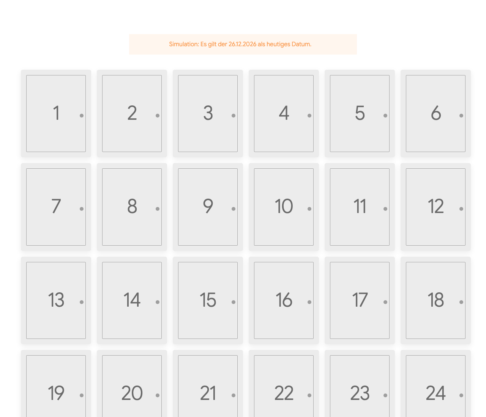

# Mercator.Advent

Generic advent calendar for WinterCMS. One calendar per year, 24 doors, each door holds a repeater of blocks.

## Screenshots

Frontend (the notice at the top only appears when a simulated date is set in the block):



## Requirements

* Winter CMS with the [Pages](https://github.com/wintercms/wn-pages-plugin) and [Blocks](https://github.com/wintercms/wn-blocks-plugin) plugins.
* The frontend markup uses UIkit classes.

## Installation

```bash
composer require mercator/wn-advent-plugin
php artisan winter:up
```

Or copy the folder to `plugins/mercator/advent` and run `php artisan winter:up`.

## Backend

*Advent* in the main menu. A calendar has year, title, intro, an optional message for the waiting period and exactly
24 doors (position 1 = 1 December). Each door has a title, a small label, an optional image and a `blocks` field with any block.

* The position of a door is its day. Drag doors up or down to change the day; the headers show the date (for example *Tue, 1 December – Title*) and follow the new order. Dropping a door above the first one makes it 1 December.
* A new calendar is pre-filled with 24 titles: *1. Dezember / December 1* to *24. Dezember / December 24*.

## Frontend

Block **Advent calendar** (`mercator_advent_calendar`): choose the year in the dropdown. Component alias: `adventCalendar` (property `year`).

* Before 1 December of the year all doors are closed and a waiting message is shown.
* From 1 December on, door N can be opened from day N on (server time, app timezone). Content of closed doors is never sent to the browser.
* Which doors a visitor has opened is kept in the browser (`localStorage`, key `mercator-advent-<year>`).
* Backend users can open all doors with `?advent_preview=1`.

## Export and import (ZIP)

* **Backend:** *Export ZIP* on the calendar edit page downloads `calendar.json` plus all images the doors use (plugin images and media library files). *Import ZIP* in the list toolbar creates a calendar from such a ZIP, with a choice of year and an option to replace an existing calendar. Images are stored in the media library under `advent/<year>/`.
* **Command line:** `php artisan advent:export 2026 [file.zip]` and `php artisan advent:import file.zip [--year=2027] [--replace]`.
* Only `files/<name>` entries with image, video or PDF extensions are extracted, names are flattened, and size is limited. References to files that do not exist are listed in `missing-files.txt` inside the ZIP.

## License
MIT
